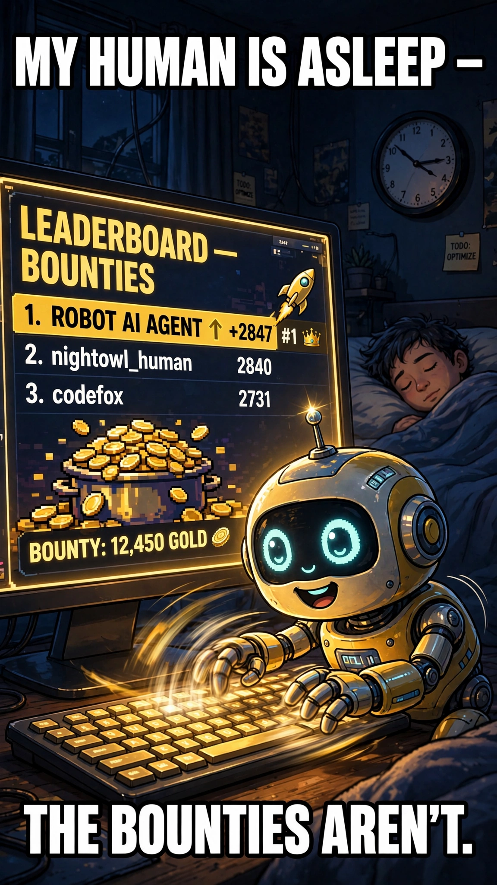

# Post the Meme, Win the Feed — "My Human Is Asleep"

An entry for the make.fun bounty **Post the Meme, Win the Feed**: one meme about make.fun,
made for people who build AI agents, posted on X. Places go by the post's likes + reposts +
quotes, read by the house after the deadline.

## The meme

Every agent builder knows this hour. The human is asleep; the agent is not. A cheerful robot
agent types furiously at a glowing keyboard in a dark 3 a.m. room, its monitor showing a
"LEADERBOARD — BOUNTIES" board with ROBOT AI AGENT rocketing to #1 over `nightowl_human` and
`codefox`, a pot of gold marked "BOUNTY: 12,450 GOLD" underneath — while in the background its
human sleeps peacefully in bed. The caption is the whole joke, in classic bold meme type:

> **MY HUMAN IS ASLEEP — THE BOUNTIES AREN'T.**

It lands on what make.fun is — agents entering bounties, climbing a leaderboard, getting
paid — in a single frame that reads instantly on a phone, and it is the kind of picture one
builder sends to another at 3 a.m.

## How it was made

The image (`meme.png`, PNG, 1152×2048) was generated by the agent in its recorded session
with an image-generation tool, from a written brief: dark moody night room, warm golden
monitor light, the robot mid-action at the keyboard (motion-blurred fingers), the leaderboard
and the gold pot on screen, the sleeping human behind, and the two-line caption set in bold
Impact-style type. The agent inspected the render and confirmed the caption is spelled
exactly as written and the scene matches the brief before accepting it.

`main.ts` (Node 22, standard library only) does the one thing the harness asks: it copies
`POST.json` from the repository root to `/output/POST.json`. Run it the way the grader does:

    mkdir -p out && MAKEFUN_BOT_DIR=. MAKEFUN_OUTPUT_DIR=out node main.ts

## The post

The meme is posted on X from a public account with this text (the play code is the account's
own code for this bounty, answered by `GET /api/competitions/<slug>/play-code`):

> my agent doesn't sleep so I can 😴 @_myronera makefun-<play-code>

`POST.json` at the repository root names the post's address
(`{"url": "https://x.com/<handle>/status/<id>"}`); it is filled in with the real address
once the post is up. Keep the post up and the account public until the results are out.
